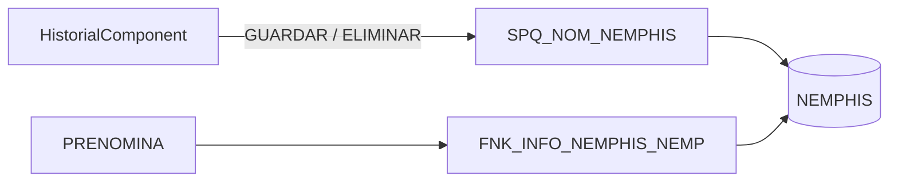
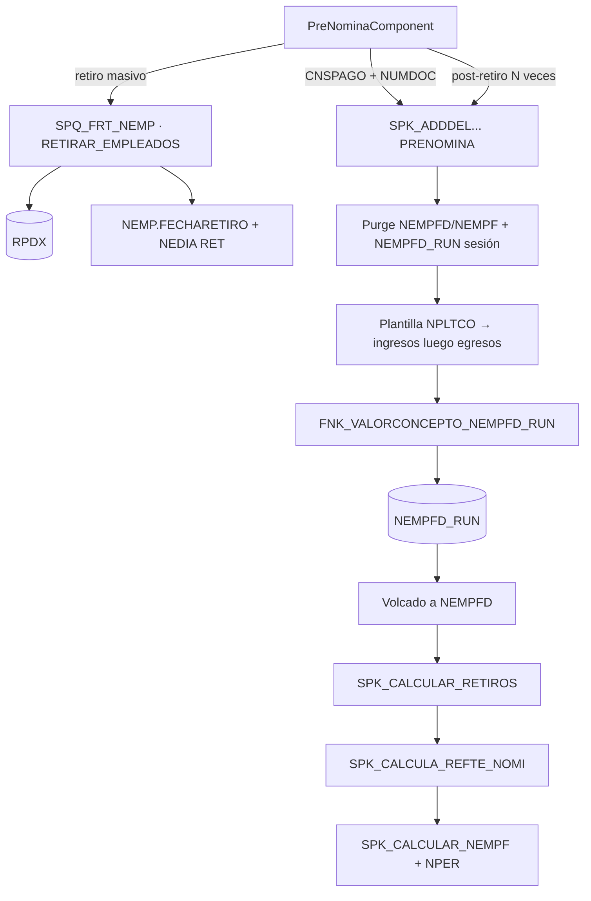
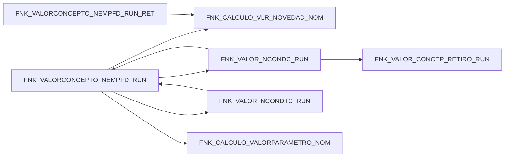

# Proceso: NOMINA

**Estado:** parcial (capa 2 leída; capas 3–5 con evidencia FE/SP 2026-09-12; capa 1: NEMPHIS y colilla siguen esqueleto por REQ)  
**Módulo:** NOMI · Talento humano → Procesos nómina / Configuraciones avanzadas  
**Destilado:** chat Documentar `c202609070558491bd1` + `c202609120734579ab7`. Fichas METODO en `sps.json`.

> Solo flujo y explicación. Detalle por parámetro y reglas en `sps.json`; aquí la cadena operativa y el rol de cada método.

## Resumen

La nómina opera sobre un **período de pago** (`CNSPAGO` / `NPER`). La **prenómina** carga conceptos, novedades y retiros sobre los empleados del período antes de liquidar y pagar.

**Ruta:** Menú central → **Talento humano** → **Procesos nómina** → pestaña **Prenómina** (`/nom/Nom_procesos`, `PreNominaComponent.vue`). Permiso: `USGRUH` · `MENUQ_NOMINA` / **Prenomina**.

**Invariante:** Todo cálculo queda sobre un `CNSPAGO`. Los conceptos liquidados persisten en `NEMPFD`; el staging de sesión usa `NEMPFD_RUN` (por `HOST_NAME()`).

## Flujo del proceso — Histórico de empleado / NEMPHIS (esqueleto · REQ 0100016359)

**Ruta:** RRHH → **Configuraciones avanzadas nómina** → pestaña **Empleados** → modal **Histórico De Empleado** (`/nom/conf`, `HistorialComponent.vue`).

**Qué hace (rol de negocio):** el usuario crea, edita o elimina un ítem del histórico laboral (`NEMPHIS`). Cada fila es un snapshot (área funcional `IDAREA`, centro de costo `CCOSTO`, cargo, básico, fechas). La prenómina consume ese histórico vía `FNK_INFO_NEMPHIS_NEMP` según `FECHAMOV`.

**Visto en FE (sin afirmar el SP):**

- Lectura: `AppStore.read` tabla `NEMPHIS`. `IDAREA` sí viene; **`CCOSTO` no está** en `ColumnasVisibles` ni en el formulario.
- Guardar: `NOM_NEMPHIS` · `GUARDAR` (payload = objeto del formulario; hoy `IDAREA` es texto libre, no hay campo `CCOSTO`).
- Eliminar: `NOM_NEMPHIS` · `ELIMINAR`.
- Patrón de catálogo AFU + CEN por área ya existe en `CargosComponent.vue` (mismo módulo).

**Tabla documentada:** `qrystalos.documentacion/tablas/NEMPHIS.md` — `IDAREA` (FK AFU), `CCOSTO` (referencia lógica CEN).

**Pendiente documentar (bloquea el dictamen del REQ):**

1. Bajar `SPQ_NOM_NEMPHIS.sql` a `sql/` y fichar **GUARDAR** / **ELIMINAR**.
2. Confirmar si GUARDAR escribe `CCOSTO` e `IDAREA`, valida FK y si sincroniza `NEMP`.
3. Bajar y fichar `FNK_INFO_NEMPHIS_NEMP` (¿devuelve área/centro por `FECHAMOV`?).

**No continuar el análisis de desarrollo** de 0100016359 hasta cerrar este control en Documentar.

## Flujo del proceso — Prenómina

1. **Abrir período** — El usuario elige el `CNSPAGO` activo. La grilla muestra empleados del período (`NEMPF`).
2. **Cargar / recalcular conceptos** — Por empleado o en lote (`AddConXCar` / `processEmploye`), el FE invoca `ADDDEL_CONCEPTOS_DE_CARGOS_NUMDOC.PRENOMINA` con `PROCESO=ADD`, `CNSPAGO` y `NUMDOC`.
3. **Retiros masivos** — `RetiroNempComponent` → `SPQ_FRT_NEMP` · `FRT_NEMP.RETIRAR_EMPLEADOS` (staging `RPDX`, métodos auxiliares CARGAR/VALIDAR/EXPORTA) en **una** ejecución batch: marca `NEMP.FECHARETIRO`, inserta `NEDIA` RET y `SPK_ADD_HISTORICO_NEMP`; devuelve `NUMDOC` procesados.
4. **Recálculo post-retiro** — Al cerrar el modal (`closeRemoMassiveNEMP`), el FE recorre empleado a empleado y vuelve a ejecutar `PRENOMINA` por `NUMDOC` (el SP de retiro **no** llama al motor SQL). Con 500+ retiros es un cuello de botella conocido (N round-trips HTTP; no es regla de negocio).
5. **Salidas** — Exportación Excel y colillas (sin control SQL documentado aún).

**Siguiente en el flujo global:** liquidación del `CNSPAGO` (`SPQ_LIQUIDACION`) → envío DIAN (`NOM_DIAN`) → CxP (`NC_CONTAB_NOMINA` · `GENERATE_CxP_NOM`, sin .sql) → contabilizar (`CONTABILIZAR`, sin .sql).

**Suboperaciones en la misma pantalla:** novedades masivas, conceptos masivos, recálculo unitario por fila (mismo patrón `processEmploye`).

## Cadena SQL — métodos y roles

### Orquestador: `SPK_ADDDEL_CONCEPTOS_DE_CARGOS_NUMDOC` · **PRENOMINA**

Parámetros clave: `@OPERACION='ADD'`, `@CNSPAGO`, `@NUMDOC`.

| Paso | Qué hace |
|------|----------|
| Purge | Borra `NEMPFD`/`NEMPF` del empleado y su `NEMPFD_RUN` de sesión |
| ADD | Crea ítem `NEMPF` CAR*; recorre plantilla (`NPLTCO` / `FNK_INFO_NEMPHIS_NEMP`): **ingresos**, luego **egresos** con tope `PTOPE` |
| Cálculo | Por cada concepto llama `FNK_VALORCONCEPTO_NEMPFD_RUN` → staging `NEMPFD_RUN` |
| Volcado | Copia líneas calculadas a `NEMPFD` |
| Retiros | `SPK_CALCULAR_RETIROS` según `FORMALIQRETIROS` |
| Retefuente | `SPK_CALCULA_REFTE_NOMI` (`@PROCEDENCIA='Nomina'`) |
| Totales | `SPK_CALCULAR_NEMPF` y actualización de `NPER`; opcional auxilio transporte y salario promedio |

**Notas:** sin RAISERROR en el script; operaciones distintas de ADD solo hacen purge inicial. Rama ADD es la del control prenómina.

### Post-cálculo en PRENOMINA

| Objeto | Rol |
|--------|-----|
| **SPK_CALCULAR_RETIROS** (`@CNSPAGO`, `@NUMDOC`) | Si hay RET en `NEDIA`: rama `FORMALIQRETIROS` ≠ OTRASIPS → conceptos `NEVED` a `NEMPFD_RUN` vía `FNK_VALORCONCEPTO_NEMPFD_RUN_RET` (reglas 043/044/vacaciones); rama **OTRASIPS** → `SPK_LIQUIDAR_NOMI_NEMP` (provisión `NIEPE`/`NIEPED` vía `FNK_LIQUIDAR_NOMI_NEMP`) + `SPK_PROCESO_VACACIONES.ACTUALIZA` + `SPQ_ADELANTO_CESAN.APLICAR` → `NEMPFD` (prima, cesantías, vacaciones, indemnización) |
| **SPK_CALCULA_REFTE_NOMI** | `RETTER`+`RETUVT` → `RETEL`/`RETELD`; actualiza o borra concepto `IDCONCEPTO_RETEFTE` en `NEMPFD`. Método **CXP** documentado pero fuera del control prenómina |
| **SPK_CALCULAR_NEMPF** | Totales `NEMPF` (neto, %egresos, `PLIBRE_EGRESOS`) y `PSOBREINGRESOS` en `NEMPFD` desde líneas `LIQUIDAR='Si'` |

### Motor de valor de concepto (núcleo)

| Objeto | Rol |
|--------|-----|
| **FNK_VALORCONCEPTO_NEMPFD_RUN** | Calcula **una línea** de concepto en `NEMPFD_RUN` según `NCOND`/`NCON`: bases Laborado, Básico, BasePrestaciones, SalarioNeto, Conceptos, Fórmula, Cuota; clases Manual, Tabla, Familiares, Particular, Aporte; horas desde `NEDIA` (ingreso parcial, retiro); `SEREPITE` por novedad; redondeo PILA centena. Auto-recursiva en fórmulas |
| **FNK_VALORCONCEPTO_NEMPFD_RUN_RET** | Misma estructura para **retiros** (`SPK_CALCULAR_RETIROS`); sin validar frecuencia periódica; reglas 018/019/033 sobre `NEMPFD_RUN`; rechaza `VALOR_CALCULO<=0` |

### Bases y dependencias del motor (llamadas desde RUN)

| Objeto | Rol |
|--------|-----|
| **FNK_CALCULO_VLR_NOVEDAD_NOM** | Agrega `NEDIA` del empleado ligadas al concepto (`NEVE`/`NEVEC`); suma `(horas+min/60)×FACTOR×valor_hora` y cantidad; devuelve también `VALOR_CALCULO100P` sin factor. Join `NPER` según `TIPOLIQ` (PorPago/PorFecha/PorFechas) |
| **FNK_VALOR_NCONDC_RUN** | Cursor sobre `NCONDC`; por cada `CODCONCEPTO_BASE` llama `FNK_VALORCONCEPTO_NEMPFD_RUN` si `REQUIERELIQ=0` o si la base ya está en `NEMPFD_RUN` de la sesión; **override** con `FNK_VALOR_CONCEP_RETIRO_RUN` si el concepto base es de retiro (`NEVED` RET) |
| **FNK_VALOR_NCONDTC_RUN** | Cursor sobre `NCONDTC`; por cada base llama `FNK_VALORCONCEPTO_NEMPFD_RUN` y acumula con `FACTOR` y `OPERACION` (+/−/*/÷). Sin override de retiro |
| **FNK_CALCULO_VALORPARAMETRO_NOM** | `TOP 1 VALOR` de `NPARV` con `FECHAFIN≥@FECHAFIN`; 0 si no hay fila. Usado en `NCONDD` tipo Parámetro |
| **FNK_VALOR_CONCEP_RETIRO_RUN** | Requiere `NEDIA` RET; básico diario × suma `DIASG` de `NEMPVD` (`PROCE='Retiro'`). Override en `FNK_VALOR_NCONDC_RUN` |
| **FNK_CALCULO_VALORCONCEPTO_NOM** | Motor table-valued hermano de RUN (mismas bases/clases, **sin** staging `NEMPFD_RUN`); auto-recursivo en fórmulas. Bases Conceptos/Tabla aún referencian `FNK_VALOR_NCONDC`/`FNK_VALOR_NCONDTC` legacy |

### Retiro masivo y anidados OTRASIPS

| Objeto | Rol |
|--------|-----|
| **FRT_NEMP** · **RETIRAR_EMPLEADOS** (`SPQ_FRT_NEMP.sql`) | Retiro masivo batch: cursor `RPDX` validadas (`CANTIDAD10=0`) → `NEMP.FECHARETIRO` + `NEDIA` RET (`FORMALIQUIDACION` PorFecha, `CNSMASIVO`) + `SPK_ADD_HISTORICO_NEMP`; devuelve `NUMDOC` para recálculo FE. Auxiliares: **CARGAR**, **VALIDAR**, **EXPORTA** sobre `RPDX` |
| **SPK_LIQUIDAR_NOMI_NEMP** | Provisión de liquidación por empleado (rama OTRASIPS): purge `NIEPE`/`NIEPED`, inserta desde `FNK_LIQUIDAR_NOMI_NEMP`, totales `NPER`, `NPERP`/`NPERPD`, recobros `NIEPER`. **No** es el SP del botón Liquidar (cierre `NPER`) |
| **SPK_PROCESO_VACACIONES** | `ACTUALIZA`/`CIERRE`/`ABRE` sobre `NEMPV`/`NEMPVD`; prorrateo `DIASG` con `FNK_DATEDIFF360` hasta fecha de retiro |
| **SPQ_ADELANTO_CESAN** | `APLICAR`/`DESAPLICAR` adelantos `NACE` FIFO contra monto de cesantías en liquidación de retiro |

## Flujo del proceso — Liquidación de nómina (esqueleto)

**Ruta:** Menú central → **Talento humano** → **Procesos nómina** → pestaña **Liquidación** (misma ruta `/nom/Nom_procesos`, `ProcesosPage.vue`; componente hijo **pendiente confirmar FE**).

**Qué hace (rol de negocio):** sobre un `CNSPAGO` ya calculado en prenómina, el usuario **cierra la liquidación** del período: valida que empleados y conceptos estén completos y marca el período como cerrado (`NPER.CERRADO`).

**Precondiciones (desde prenómina documentada):**

- `NEMPF` / `NEMPFD` calculados (`PRENOMINA` OK por empleado).
- Sin egresos bloqueados por tope `PTOPE` pendientes de resolver (líneas `LIQUIDAR='No'`).
- Retiros procesados si aplican.

**Invariante cruzada:** el cierre contable de mes consulta `NPER` — si `CERRADO=0` reporta «NOMINAS PENDIENTES POR CERRAR» (`SPQ_CONTABILIDAD`, referencia en `sql_refe`).

**Pendiente documentar:** MODELO/METODO del botón liquidar, validaciones RAISERROR, tablas auxiliares (`NIEPG`, provisión `NIEPED` si interviene), reversión de liquidación.

## Flujo del proceso — Envío DIAN / nómina electrónica (esqueleto)

**Ruta:** Menú central → **Talento humano** → **Procesos nómina** → pestaña **Envío DIAN** (o **Nómina electrónica** — nombre exacto pendiente FE).

**Qué hace (rol de negocio):** transmite a la DIAN la información del período **ya liquidado** (nómina electrónica / planilla NE — **no** es el circuito `FTR_COL`·`NOTI_DIAN` de facturación electrónica).

**Configuración previa (referencia cruzada, no control facturación):** parámetro `TGEN` · `FDIAN` · `SOFTWARE_NOMINA` expuesto en `SPQ_FDIAN_COL.GET_DATOS_FDIAN` (`sql_refe`).

**Flujo operativo esperado (pendiente confirmar con .sql):**

1. Elegir `CNSPAGO` liquidado (`NPER.CERRADO=1`).
2. Generar archivo/XML/plano NE desde `NEMPFD` / tablas PILA.
3. Enviar al operador/DIAN; persistir estado y respuesta.
4. Reenvío o corrección si la DIAN rechaza.

**Pendiente documentar:** SPQ/SPK de generación y envío, estados de trazabilidad, permiso USGRUH, componente Vue.

**Sin leer `.sql` hoy** — no hay scripts de liquidación/NE en `sql/` ni `FE/docs/`; la ficha de nómina no cubría este pedido.

## Tablas clave

`NPER`, `NEMP`, `NEMPHIS`, `NEMPF`, `NEMPFD`, `NEMPFD_RUN`, `NEDIA`, `NEVED`, `NCONDC`, `NCONDTC`, `NPARV`, `NEMPVD`, `RPDX`, `NPLTCO`, `AFU`, `CEN`.

## Capas del proceso

| # | Capa | Estado |
|---|------|--------|
| 1 | Configuración | Esqueleto — control **empleados-historico** (NEMPHIS) abierto; resto pendiente |
| 2 | **Prenómina** | **Cerrado** — PRENOMINA, motor FNK_*, retiro masivo y anidados OTRASIPS |
| 2b | **Liquidación** | Esqueleto — SP/FE pendientes |
| 2c | **Envío DIAN (NE)** | Esqueleto — SP/FE pendientes |
| 3 | Lo que llega y completa (novedades, cargos base) | Pendiente |
| 4 | Subproceso unido (bancos) | Pendiente |
| 5 | Envío a contabilidad | Pendiente |

## Pendiente

- [x] `FNK_LIQUIDAR_NOMI_NEMP` — ficha en `sps.json` (anidado de `SPK_LIQUIDAR_NOMI_NEMP`).
- [ ] **Liquidación:** confirmar FE + bajar SP cierre `NPER` a `sql/`.
- [ ] **Envío DIAN (NE):** bajar SP generación/envío; documentar estados y reenvío.
- [ ] Legacy sin script en repo: `FNK_VALOR_NCONDC`, `FNK_VALOR_NCONDTC`; `FNK_ESBISIESTO` sin ficha.
- [ ] Controles posteriores: pago, bancos, contabilidad (capa 5).
- [ ] **REQ 0100016359 — bloquear dictamen:** `SPQ_NOM_NEMPHIS` (GUARDAR/ELIMINAR) + `FNK_INFO_NEMPHIS_NEMP` en `sql/` y fichas `leido`.
- [ ] Configuración restante (conceptos, cargos, períodos, permisos).
- [ ] Dictamen rendimiento: recálculo masivo post-retiro batch en servidor (fuera de alcance operativo actual).
